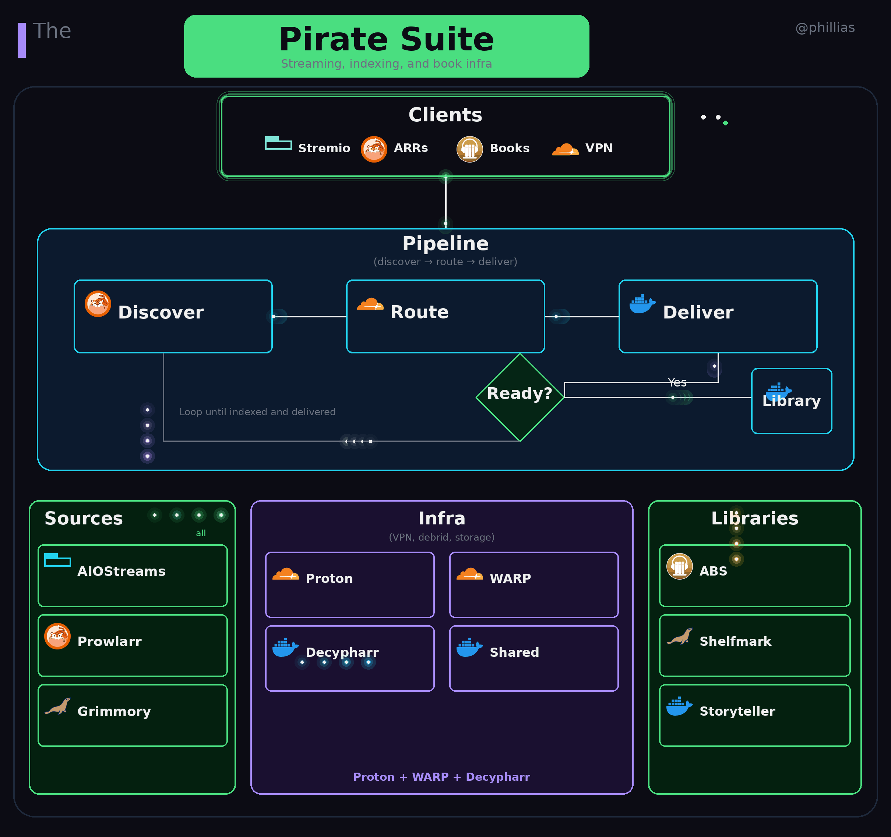

# FROZEN SNAPSHOT — do not run or modify

This directory is a **frozen snapshot** (chowned root 2026-10-26). The LIVE
pirate stack runs from `~/firstmate/projects/pirate` (compose + bind mounts +
BWS `PIRATE_*` secrets). Rotate credentials there; changes here are
historical only and mirror to the public repo phillias/pirate.

# Pirate Suite
## For pirating media.  Movies, Series, ebooks, audiobooks
docker compose for aiometadata, aiostreams, syncio, jackett, prowlarr, nzbhydra2, audiobookrequest, audiobookshelf, shelfmark, openbooks, etc.
all relative directory bind mounts

cloudflare and proton vpn's.  Flaresolverr/Byparr for cloudflare human checks.

# Architecture

The stack is organized into three layers:
- **Clients**: Stremio/AIOStreams for streaming, Prowlarr/Jackett/NZBHydra2 for indexing, book apps (Grimmory, ABR, OpenBooks) for reading
- **Infrastructure**: Proton (Gluetun) and Cloudflare WARP for VPN/tunneling, Decypharr for debrid resolution, shared volumes for cross-container access
- **Libraries**: Audiobookshelf for audiobooks, Shelfmark for book metadata, Storyteller for synced reading

Data flows from clients through indexers, gets routed via VPN tunnels to debrid services, and delivers content to Stremio or disk-mounted libraries.

# Tools

## Nuvio/Stremio Tools
|Tool | Use |
|:----|:----|
|https://uptime.ibbylabs.dev/ | Services Uptime Tracker |
|https://duckkota.gitlab.io/stremio-tools/ | Addon Butler **MUST** for addon ordering and locking |
|https://stremio-account-addon-cloner.vercel.app/ | **MUST** for quick replication to other stremio accounts |
|https://uptime.ibbylabs.dev/ | Ecosystem monitoring |
|https://debridmediamanager.com/ | best torz search linked to torbox/RD/etc for auto-adding and casting | 
|https://56bca7d190fc-syncribullet.baby-beamup.club/ | Scrobbling many, not trakt |
|https://easyratingsdb.com/ | RPDB alt wrapper proxy addons to replace posters, self hosted option |
|https://ratingswrapper-production.up.railway.app/ | Proxy adds ratings to titles, with episode specific ratings from IMDB |
|https://aiomanager.fortheweak.cloud/ | addon and login management, addon failover, activity and analytics year in review   |
|syncio | had problems, complicated |
|https://cinemeta.ratingposterdb.com/configure |	Add RPDB to cinemata |
|https://cinebye.dinsden.top |	removes cinemata search/catalogs/metadata |
|https://hidden-cinemeta.vercel.app/ |	for hiding cinemata catalogs (top and imdbRating) |
|https://aiosubtitle.org/ |	Maybe?  Costs. |
|https://addon-manager.viren070.me/ |	re-order addon's including cinemata |
|https://mytrakt.elfhosted.com/	 | |
|aiometadata | nice for cache warming but **TOO SLOW, just use Cinemata** |
|aiopicks | **BROKE/SKIP** ((for trakt accounts with no watch history?)) ||	
|https://bitmagnetfortheweebs.midnightignite.me/torznab/api | Public torznab used in AIOStreams and prowlar, url/api found in medifusionfortheweebs.midnightignite.me (API key redacted from public docs) |

## Torbox Tools
|Tool | Use |
|:----|:----|
|https://tbm.tools/ | Torbox Manager with automation rules for inactive, stalled, incomplete |
|https://tordeck.com/ | analytics, automated management tasks in torbox |
|https://debridvault.elfhosted.com/ | all media consumption find analytics, ARR's connected, Eclipse audio app incoming |

## Ebook Tools
|Tool | Use |
|:----|:----|
|https://books.tbm.tools/| Stremio for ebooks and audiobooks |

## Seeding Tools
|Tool | Use |
|:----|:----|
|https://trackerpathways.org/ | Invite heirarchy |
|https://www.reddit.com/r/OpenSignups/ | Useful sometimes |
|https://scenegroups.chromeknight.dev/ | Scene groups encyclopedia |
|https://dashboard-45-152-210-245.a.seedbox.vip/ (creds in vault) | My seedbox |
|https://45-152-210-245.a.seedbox.vip/rutorrent/ (creds in vault) | My seedbox rtorrent |
|https://my.racknerd.com/index.php?rp=/store/special-promos | good hosting option |

# Stremio

## Trakt lists 
only latest movies garyc and glidg are not origin sourced from MDBList and added to aios.phillias.cc
| List | MDBList |
|:-----|:--------|
|https://trakt.tv/users/philliashome/lists/movies-recommendations-couchmoney-tv?sort=rank,asc | |
|https://trakt.tv/users/philliashome/lists/tv-recommendations-couchmoney-tv?sort=rank,asc | |
|https://trakt.tv/users/garycrawfordgc/lists/latest-releases?sort=added,asc |
|https://trakt.tv/users/garycrawfordgc/lists/latest-tv-shows?sort=added,asc | https://mdblist.com/lists/garycrawfordgc/latest-tv-shows |
|https://trakt.tv/users/omar-comin/lists/latest-releases?sort=added,asc | https://mdblist.com/lists/omar-comin/latest-digital-releases |
|https://trakt.tv/users/omar-comin/lists/latest-tv-shows?sort=added,asc | https://mdblist.com/lists/omar-comin/latest-tv-shows |
|https://trakt.tv/users/giladg/lists/latest-releases?sort=added,asc | |
|https://trakt.tv/users/hdlists/lists/latest-streaming-service-tv-shows?sort=added,asc | https://mdblist.com/lists/hdlists/latest-streaming-service-tv-shows-wfmq8r8kyk |
|https://trakt.tv/users/hdlists/lists/latest-tv-shows?sort=added,asc | https://mdblist.com/lists/hdlists/latest-tv-shows |

## Public Aiostreams Instances
| Manifest URLs | Limitations |
|:-------------------------------|:------------|
|[12312023 manifest](https://aiostreams.12312023.xyz/stremio/15bde33d-c33a-4afe-b563-79c2f2181110/eyJpIjoiWEpPMmpUZFkyVHB5TWhPMVVsREl4Zz09IiwiZSI6IkZVc0h6S21NTXVsU0JpSGRLS1Zvb0ZnUEJ4d3dXQmNhamhzUjg0UmxHSEk9IiwidCI6ImEifQ/manifest.json) |	torrentio blocked |
|[nhyira manifest])https://aiostreamsfortheweak.nhyira.dev/stremio/1311f39a-e1c2-46e1-96a9-cfb287984604/eyJpIjoiRGlvbkJ6NjlPQXRPNXRBcitYeXJmUT09IiwiZSI6Imp0OFR3dDJJOUVSR1g0MnA1TzdTMHBGL0FBM3FkQ09Nc3J3bUZseVRFbnc9IiwidCI6ImEifQ/manifest.json) |	dexter trakt and subtitles blocked |
|[stremiofr](https://aiostreams.stremiofr.com/stremio/48d774f1-9c54-4f5c-b404-5a027615767d/eyJpIjoiN0ZPcHBGczBybW9xZmd2VUZLaGw5Zz09IiwiZSI6IjdialdhaHdFb3MwWVg3czhUb0lKV2dodmNiQndPc203aDZ1MUJ4N3lUb289IiwidCI6ImEifQ/manifest.json) |	max 15 addons |
|[viren70](https://aiostreams.viren070.me/stremio/5af8f0c4-4273-48c5-ada3-b81eea5312f9/eyJpIjoiM2pvY1dtSlVIM21NVjVieWM2OTFNZz09IiwiZSI6IlhFVzF1c095L0VyajJsTXYyMXhRS0ZHaVlmVkFwdms2YUNCMHVGMENlOWs9IiwidCI6ImEifQ/manifest.json) | torbox addon and stremthru store blocked |
|[FTW manifest](https://aiostreamsfortheweebs.midnightignite.me/stremio/545d0d2c-b992-4f6d-9c71-f8b2f69f4da8/eyJpIjoiNzM2V1ZRTGZqZmw1OUNkSXNqUXJPZz09IiwiZSI6InptZ3dmMDF1emNQQ3RXTUVGeWVYKzMyQ05hZ09NSGIvOWU4MDM1QWM5dlU9IiwidCI6ImEifQ/manifest.json) | |	

## Design
|Item	| Reason | Catalogs | Manifests |
|:------|:-------|:---------|:----------|
|[cinemata with rpdb](https://cinemeta.ratingposterdb.com/) -> [ratingswrapper](https://ratingswrapper-production.up.railway.app) | quick standard catalogs and metadata | Popular/Featured | [manifest](https://ratingswrapper-production.up.railway.app (manifest regenerated privately — userId redacted)) |
|Trakt -> RatingsWrapper
<ul><li>Log into trakt.tv and app.trakt.tv and refresh both to make sure the right account is present.</li><li>Then web.stremio.com->Settings->Trakt Scrobbling adds the Trakt Integration addon with catalogs</li><li>Also configure stremio.com->Integrations->Trakt Scrobbling</li><li>Extract addon manifest url with AioManager and put through [ratingswrapper](https://ratingswrapper-production.up.railway.app/) and replace in stremio</li></ul> | Trakt account/device specific recommendations| Trakt Recommendations | [manifest](https://ratingswrapper-production.up.railway.app (manifest regenerated privately — userId redacted)) |
|Torrentio | fast and good results. installed directly on each stremio instance because it's blocked from Oracle cloud and most hosted instances of aiostreams | none | [manifest](https://torrentio.strem.fun/qualityfilter=brremux%7Cdebridoptions=nodownloadlinks/manifest.json (torbox key redacted)) |
|[Duck Streams]( https://duckkota.gitlab.io/stremio-tools/) |	Easy AIOStreams for HQ | None | [manifest](https://aiostreamsfortheweak.nhyira.dev/stremio/da94f31d-1829-4382-8f12-b1c33f02eaaa/eyJpIjoiVXZJTVl4SmRZbVlDaGNmQk04Q3F2Zz09IiwiZSI6Im1PWSsvcDVQYndDTk9tTjRsVkcvVDdreld4SGw3Z1YzbFJlN0RHdjBOVUE9IiwidCI6ImEifQ/manifest.json) |
|[aios.phillias.cc](https://aios.phillias.cc) on oracle cloud, master account; proxied through [easyratingsdb.com](https://easyratingsdb.com) for cool poasters | Slow thorough sourcing, maximal control | All the catalogs | [manifest](https://aios.phillias.cc (master manifest regenerated privately — keys redacted))
|[Addon Butler](https://duckkota.gitlab.io/stremio-tools/) | quick reordering of addons | NA | NA |
|[Account Cloner](https://stremio-account-addon-cloner.vercel.app/) | quick account cloning to other devices/accounts | NA | NA |
|[AIOManager](https://aiomanager.fortheweak.cloud/) | Detailed customization: Catalog editing; addon management, addon instance library (sort of a backup), addon update notification, addon failover; account management; year in review; etc | NA | NA |

## Some random other assets set up while experimenting 
| Account | Service | Manifest | Description |
|:--------|:--------|:---------|:------------|
| master | trakt dexter | https://trakt.dexter21767.com/2563f20b-cb00-4dd7-b970-359001d41512/manifest.json |	philliashome, no recommendations |
| master | aiostreams | https://aiostreams.phillias.us/stremio/f251ec47-952c-4b57-b2f5-9b181d638017/eyJpIjoieFhZTjRsTnpCT1EwQUZvTDVyajI2Zz09IiwiZSI6Ik4vc1B6cEw4TkxCem94QmxSS0krdkx0YUs4SVR4cnJ1S1grOUtZUU9jbk09IiwidCI6ImEifQ/manifest.json | **not valid** hosting moved to oracle, manifest changes each save. |	
| master | aiometadata | https://aiometadata.phillias.us/stremio/c96e548b-aa30-48bf-b885-d5e4c6786475/manifest.json | **not valid** stopped hosting, too slow compared to cinemata |
| master | aiopicks | https://aiopicks.fusionapp.dev/profiles/philliashome/manifest.json | don't use, premium service |
| master/philliashome | aiolists | [manifest](https://aiolists.elfhosted.com/H4sIAAAAAAAAA8VYW1fiSBD-K55-Tpykc88bDqOLKzBKHIU9njmd7gppzYXpBBA8_Pc9DQQEQXHWcd-g7lXd9VWlnxAZ8L9hgnw0mWREj7JpOP3lTYnjDkmEJ_ok7iMFiQELa5VgiVWqUwc7tqValJiqqTFdDYntqZQRgzIKHhCMFFSmLDwBIkAE-QNkyEcwOY_DM8rb_LxxPW3oLX7uHUsiu7mUxLh3dv3YSi_N9s210UwbRjPoWq16ct8NrtJ28G3cxb24e38StzuNopFavMcbdjOgWqven7brl5NWx7SawcO4Wa89Xnw9n7KbBm_zBm7Xa-PmTfexHfSn3WkvaQVdoztlD-3gx0Pr7BuXsl3sjXu3Td5OCt69PRncGudJ9-aS33bGnKU_JhQno1D6u9WOH0_P1aBJR2lgX0SNW-0srGfW7enX--QXbk_j3l9BlEdwdtqJr5eF6EBR8DxrMOQjgj1L1yIHY2JS1zKpG4HHXOy4xIDI0iPXwB5odKlaozQfZqVUxZqNLcfDC8Z1ASIjKSAfZWRwn48TpKAUSsJISTr5UFDJojwDSVxauyBZf0j6kiMpgjyUNUqhKKpDsnTQGEQuM00cEkvHjJqUuCbVdNNwCYSRZdnEpgwsAqZOwKGuY2NshxGOXAsqq1cQCSjiyizGzLSZSSzQHdvV7DB0sWnhyNE808aOa1sGjTydGMSNNC_EoOm6axHdseStcs3K7LfHARdQ1ErkS0MG1jxNdwxjyX5Wk0HMk4STIs5TGVTCi7ItGAjk_4MIz-X_Qh2Tksbyp3pTefiZ5iMOhSqA5mkKGSMlz7NCpfmQxmmewUQtRyvhcnSg4MrTirKlt_S7l13E-XjNLQVkjGf9ba0VfVN8kA-GCRHb0hV5JZyycDNSSYjIKBe8XOsNhmHC6c8-ERMqyDjKBevTnwkpoSjVcqRu-F4K5ykRKs1Tnr0hGLP50bxPqigFkJRnfbUAMeIU9untjllAAqR4keDLmDfrV9nkCWH9F7buFJSQorweMFKCbHysYVvVdFXzAg37uuYb3jHWnN7ydhbNZe8i_2n3DfWfUEyK5iIGPyJJAYqkdOaJVgTp9GsM9GGHU83wdetY18wemr3rvn-oawWBELk4hZLGPOsv1WcvW-Uzvb7ZyW8EU4rhx8Wy1d2brhee_lAZtpDiEz3vwcNPjGALPD_xwHeD_ScGsDkJPsfx5rD5zV63VB2rmh7otm8YvmEc27a1ALfN0fVR5h3D7aHZTEExZwyyCwnScqXYN-UPmrx3ChKQ5iNglb07BdFhUeapJLRIushg9zVFwZJwNE_mSD0KpNweXz76vvj_hnTVfivxRe1eyL_AqnU4ezT2XHZ0VdGB7YltH0RsqG55ncmlWPRXpX2aVaVtAuMkmAygqu9MQTwd5KIEVmMsz9Y1P2zj8Z8Ql_fmXUvScl29mDOOgh-L1JFyQAfyYp7i97mni3kTLRirXRj5aDOAqpRSupMM-8hHOxatyQDml7oAIf3fzQ7e5XaV4NXV70-nv3b-Ianv20535b1_k_3TSS89_4mMX9m0D6jBq3v6ZlU6lehRZyH6f9Tp9e-KNyr3xrfG4Wjx7PNks0bPGG_vSB-KFs-_mKoyzNH4ALBYL3YHQMVqbm5m3qzIH5T3ITCxHuGvZ7zne3Dnee8W3c726uPPee749853pqAiF-V3AREIyCj8xpyUBuRbGGPAkILyxcsMIgVF7xo2h9t5Bbl_28jrYHi42beR4r_Ua91v74ho7x1-zcZMQYwXJEzgDDIBpzwpJXN5MSGTnCuSscVaewqkHApY8cWc06yfSGb1krcA2DgflzwFU7eR8hKjEp6RYjAUPOPzFlmi-p2CCiCCxovH0Lml58-h1WqZslDKLrbEzrZGxSYZT2HB_TZPhG321XDe3JEVesyD0PWwgzVwTepYYRSFJnVsankkMi3DAc1DChoOipIU8bVI5CQqy0Hhf_mSkkeeDlM1yh_jfJgx1TSwZR8vZY95vlasnlZr5N6s1RoZrTeMXr3F5Qt4N7iWL-Faq34et4MHszntW61p8tCqU9xMLyet29qkVW9OWkEXzf4FP4MieQgYAAA/manifest.json) [configure](https://aiolists.elfhosted.com/H4sIAAAAAAAAA8VYW1fiSBD-K55-Tpykc88bDqOLKzBKHIU9njmd7gppzYXpBBA8_Pc9DQQEQXHWcd-g7lXd9VWlnxAZ8L9hgnw0mWREj7JpOP3lTYnjDkmEJ_ok7iMFiQELa5VgiVWqUwc7tqValJiqqTFdDYntqZQRgzIKHhCMFFSmLDwBIkAE-QNkyEcwOY_DM8rb_LxxPW3oLX7uHUsiu7mUxLh3dv3YSi_N9s210UwbRjPoWq16ct8NrtJ28G3cxb24e38StzuNopFavMcbdjOgWqven7brl5NWx7SawcO4Wa89Xnw9n7KbBm_zBm7Xa-PmTfexHfSn3WkvaQVdoztlD-3gx0Pr7BuXsl3sjXu3Td5OCt69PRncGudJ9-aS33bGnKU_JhQno1D6u9WOH0_P1aBJR2lgX0SNW-0srGfW7enX--QXbk_j3l9BlEdwdtqJr5eF6EBR8DxrMOQjgj1L1yIHY2JS1zKpG4HHXOy4xIDI0iPXwB5odKlaozQfZqVUxZqNLcfDC8Z1ASIjKSAfZWRwn48TpKAUSsJISTr5UFDJojwDSVxauyBZf0j6kiMpgjyUNUqhKKpDsnTQGEQuM00cEkvHjJqUuCbVdNNwCYSRZdnEpgwsAqZOwKGuY2NshxGOXAsqq1cQCSjiyizGzLSZSSzQHdvV7DB0sWnhyNE808aOa1sGjTydGMSNNC_EoOm6axHdseStcs3K7LfHARdQ1ErkS0MG1jxNdwxjyX5Wk0HMk4STIs5TGVTCi7ItGAjk_4MIz-X_Qh2Tksbyp3pTefiZ5iMOhSqA5mkKGSMlz7NCpfmQxmmewUQtRyvhcnSg4MrTirKlt_S7l13E-XjNLQVkjGf9ba0VfVN8kA-GCRHb0hV5JZyycDNSSYjIKBe8XOsNhmHC6c8-ERMqyDjKBevTnwkpoSjVcqRu-F4K5ykRKs1Tnr0hGLP50bxPqigFkJRnfbUAMeIU9untjllAAqR4keDLmDfrV9nkCWH9F7buFJSQorweMFKCbHysYVvVdFXzAg37uuYb3jHWnN7ydhbNZe8i_2n3DfWfUEyK5iIGPyJJAYqkdOaJVgTp9GsM9GGHU83wdetY18wemr3rvn-oawWBELk4hZLGPOsv1WcvW-Uzvb7ZyW8EU4rhx8Wy1d2brhee_lAZtpDiEz3vwcNPjGALPD_xwHeD_ScGsDkJPsfx5rD5zV63VB2rmh7otm8YvmEc27a1ALfN0fVR5h3D7aHZTEExZwyyCwnScqXYN-UPmrx3ChKQ5iNglb07BdFhUeapJLRIushg9zVFwZJwNE_mSD0KpNweXz76vvj_hnTVfivxRe1eyL_AqnU4ezT2XHZ0VdGB7YltH0RsqG55ncmlWPRXpX2aVaVtAuMkmAygqu9MQTwd5KIEVmMsz9Y1P2zj8Z8Ql_fmXUvScl29mDOOgh-L1JFyQAfyYp7i97mni3kTLRirXRj5aDOAqpRSupMM-8hHOxatyQDml7oAIf3fzQ7e5XaV4NXV70-nv3b-Ianv20535b1_k_3TSS89_4mMX9m0D6jBq3v6ZlU6lehRZyH6f9Tp9e-KNyr3xrfG4Wjx7PNks0bPGG_vSB-KFs-_mKoyzNH4ALBYL3YHQMVqbm5m3qzIH5T3ITCxHuGvZ7zne3Dnee8W3c726uPPee749853pqAiF-V3AREIyCj8xpyUBuRbGGPAkILyxcsMIgVF7xo2h9t5Bbl_28jrYHi42beR4r_Ua91v74ho7x1-zcZMQYwXJEzgDDIBpzwpJXN5MSGTnCuSscVaewqkHApY8cWc06yfSGb1krcA2DgflzwFU7eR8hKjEp6RYjAUPOPzFlmi-p2CCiCCxovH0Lml58-h1WqZslDKLrbEzrZGxSYZT2HB_TZPhG321XDe3JEVesyD0PWwgzVwTepYYRSFJnVsankkMi3DAc1DChoOipIU8bVI5CQqy0Hhf_mSkkeeDlM1yh_jfJgx1TSwZR8vZY95vlasnlZr5N6s1RoZrTeMXr3F5Qt4N7iWL-Faq34et4MHszntW61p8tCqU9xMLyet29qkVW9OWkEXzf4FP4MieQgYAAA/configure) | just edit in aiostreams and launch reconfigure from there.  trakt recommendations and some trakt lists that have no MDBList original source, couchmoney recommendations if possible	|
| CCWGTV1 | aiopicks | https://aiopicks.fusionapp.dev/profiles/phillias-stremio-ccwgtv1/manifest.json ||
| CCWGTV1 | trakt dexter w/ recommendations only | https://trakt.dexter21767.com/0cfce3dc-ab0e-4bbd-9383-eb3eb975066e/manifest.json ||
| CCWGTV1 | aiostreams.phillias | https://aiostreams.phillias.us/stremio/a7da5766-49f1-4a20-a83f-37970d695f22/eyJpIjoiY3FnNDlDaE5NcGJ4V0U2LzFxZWs0UT09IiwiZSI6InFqOGZkSjFDaG54SkZHZ3lQV3FqajN6aEVQaWpnUk1kRHJjcVorWHNhTUU9IiwidCI6ImEifQ/manifest.json ||
| CCWGTV1 | auth key (for cinebye) |  	55mpVaQd2RXnK6PxmTcoLgCNDLjltujr3zhf8Tc3RCk= ||

# ARR's
torrent indexer managers
1. [Prowlarr](https://prowlarr.phillias.cc/)
2. [Jackett](https://jackett.phillias.cc/)
3. [Nzbhydra2](https://nzbhydra2.phillias.cc/)

# Media Bridge
[Decypharr](https://decypharr.phillias.cc) is For managing Torbox, rclone mounting to /mnt.  More elegant than Debrid Media Bridge.

# Audiobooks
1. [Audiobookrequest](https://abr.phillias.cc/) For finding audiobooks, requests handled by prowlarr
    1. Indexer: prowlarr
    2. Meta: myanonamouse
    3. Downloader/Destination Dir: Decypharr /mnt/torbox/__all__
2. [Audiobookshelf](https://abs.phillias.cc/) For managing audiobook metadata and listening, has mobile app?
    1. Meta: 
    2. Ingestion Dir: /mnt/torbox/__all__

# Ebooks
1. [Booklore](https://booklore.phillias.cc/) For ebook management, metadata management, and reading
    1. Meta: 
    2. Ingestion Dir:
2. [ShelfMarka](https://shelfmark.phillias.cc/) For finding ebooks, broadest search
    1. Indexer: Prowlarr
    2. Meta: Hardcover, OpenLibrary, Google Books
    3. Downloader/Destination Dir: Booklore:/bookdrop by login
3. [Openbooks](https://openbooks.phillias.cc/) For finding ebooks
    1. Indexer:
    2. Meta:
    3. Downloader/Destination Dir:
4. [Storyteller](https://storyteller.phillias.cc/) For syncing ebooks and audiobooks for simultaneous experience
    1. Indexer:
    2. Meta:
    3. Downloader/Destination Dir:

# Proxies
## Cloudflare Warp on http://warp:1080
## Proton VPN via gluetun http proxy on http://proton:8888
## Flaresolverr
3 instances
1. straight from the host on http://flaresolverr:8191
2. tunneled through warp on http://flarewarp:8192
3. tunneled through proton on http://flareproton:8192?
## Byparr hardened high performance fork of flaresolverr on http://byparr:8193
